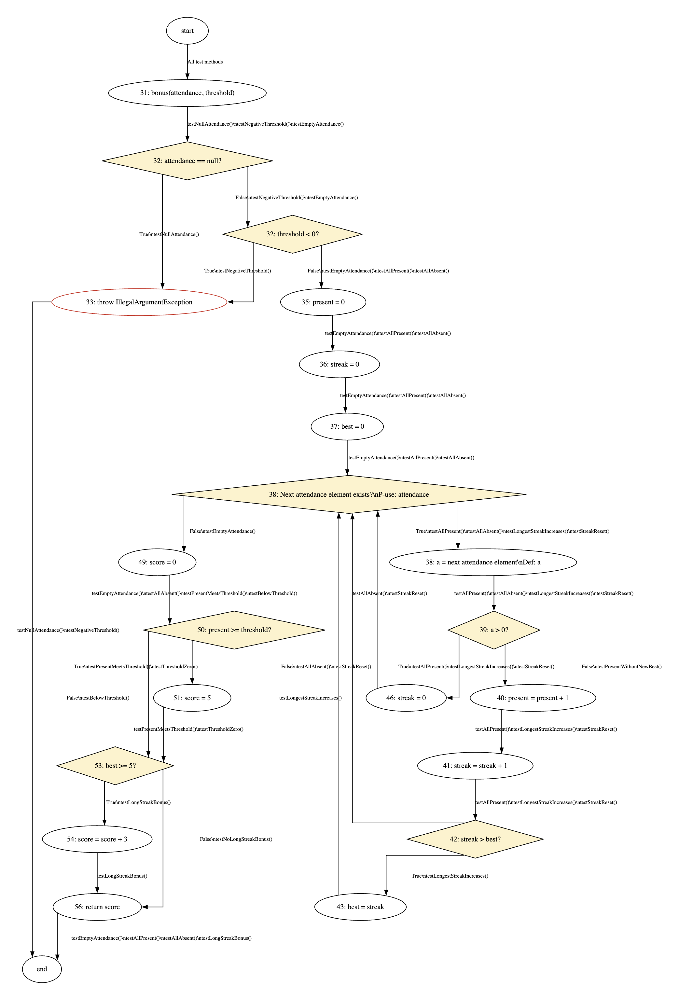

# Лаборатори №10 — Өгөгдлийн урсгалын тест: Definition-Use Pairs

**Хичээл:** F.CSA313 — Программ хангамжийн чанарын баталгаа ба тест

**Оюутны нэр:** Э. Мөнх-Очир

**Оюутны код:** B232270022

**Сэдэв:** Өгөгдлийн урсгалын тест — Definition-Use Pairs

---

# 1. Орчны мэдээлэл

## 1.1. Үйлдлийн систем

```text

OS name: macOS

OS version: 27.0.1

Architecture: aarch64

Platform: macOS

```

## 1.2. Java орчин

**Команд:**

```bash

java -version

```

**Гаралт:**

```text

openjdk version "25.0.2" 2026-01-20

OpenJDK Runtime Environment Homebrew (build 25.0.2)

OpenJDK 64-Bit Server VM Homebrew (build 25.0.2, mixed mode, sharing)

```

## 1.3. Maven орчин

**Команд:**

```bash

mvn -version

```

**Гаралт:**

```text

Apache Maven 3.9.12 (848fbb4bf2d427b72bdb2471c22fced7ebd9a7a1)

Maven home: /opt/homebrew/Cellar/maven/3.9.12/libexec

Java version: 25.0.2, vendor: Homebrew

Default locale: en_US, platform encoding: UTF-8

OS name: "mac os x", version: "27.0.1", arch: "aarch64", family: "mac"

```

---

# 2. Part A — `gcd()` Definition-Use Analysis

## 2.1. Зорилго

`gcd(x, y)` функцийн хувьсагч бүрийн Definition (Def), Computational Use (C-use), Predicate Use (P-use) цэгүүдийг тодорхойлж, Def-clear замтай DU хосуудыг гаргасан.

## 2.2. DU Pairs хүснэгт

| Variable | Def line | Use line | Use type | Def-clear path | Test ID | Covered |
|---|---:|---:|---|---|---|---|
| x | 13 | 16 | C-use | 13 → 15(T) → 16 | `testGcdWithLoop()` | Yes |
| x | 13 | 20 | C-use | 13 → 15(F) → 20 | `testGcdWithoutLoop()` | Yes |
| x | 17 | 16 | C-use | 17 → 18 → 15(T) → 16 | `testGcdWithLoop()` | Yes |
| x | 17 | 20 | C-use | 17 → 18 → 15(F) → 20 | `testGcdWithLoop()` | Yes |
| y | 13 | 15 | P-use (T) | 13 → 15(T) | `testGcdWithLoop()` | Yes |
| y | 13 | 15 | P-use (F) | 13 → 15(F) | `testGcdWithoutLoop()` | Yes |
| y | 13 | 16 | C-use | 13 → 15(T) → 16 | `testGcdWithLoop()` | Yes |
| y | 13 | 17 | C-use | 13 → 15(T) → 16 → 17 | `testGcdWithLoop()` | Yes |
| y | 18 | 15 | P-use (T) | 18 → 15(T) | `testGcdWithLoop()` | Yes |
| y | 18 | 15 | P-use (F) | 18 → 15(F) | `testGcdWithLoop()` | Yes |
| y | 18 | 16 | C-use | 18 → 15(T) → 16 | `testGcdWithLoop()` | Yes |
| y | 18 | 17 | C-use | 18 → 15(T) → 16 → 17 | `testGcdWithLoop()` | Yes |
| tmp | 16 | 18 | C-use | 16 → 17 → 18 | `testGcdWithLoop()` | Yes |

`y` хувьсагчийн 18-р мөрийн Definition-ээс 15-р мөрийн P-use рүү хүрэх зам нь давталтын дараагийн нөхцөл шалгалтаар тодорхойлогдоно. `testGcdWithLoop()` нь давталт үргэлжлэх болон дуусах нөхцөлийг хамруулна.

## 2.3. GCD тестүүд

Тестийн файл: `src/test/java/mn/edu/must/sqat/GcdTest.java`

### `testGcdWithoutLoop()`

```java

assertEquals(7, DataFlowTargets.gcd(7, 0));

```

Хүлээгдэж буй үр дүн: `7`.

Энэ тестэд `y = 0` тул `while` давталт ажиллахгүй. Анхны `x` утга return үйлдэлд хүрнэ.

### `testGcdWithLoop()`

```java

assertEquals(4, DataFlowTargets.gcd(12, 8));

```

Хүлээгдэж буй үр дүн: `4`.

Евклидийн алгоритмын тооцоолол:

1. 12 % 8 = 4

2. 8 % 4 = 0

Энэ тестээр давталтын үеийн Definition-Use хосуудыг хамруулна.

## 2.4. GCD тестийн үр дүн

**Команд:**

```bash

mvn clean verify

```

**Үр дүн**

```text

Tests run: 2, Failures: 0, Errors: 0, Skipped: 0

BUILD SUCCESS

```

---

# 3. Part B — `bonus()` Definition-Use Analysis

## 3.1. Функцийн тайлбар

`bonus(int[] attendance, int threshold)` функц нь ирцийн мэдээлэлд үндэслэн урамшууллын оноо тооцно.

Үндсэн дүрэм:

- Ирсэн өдрийн тоо `threshold`-ээс их эсвэл тэнцүү бол 5 оноо өгнө.

- Дараалсан ирцийн хамгийн урт цуваа 5 буюу түүнээс их бол нэмэлт 3 оноо өгнө.

- `attendance == null || threshold < 0` нөхцөл үнэн бол `IllegalArgumentException` үүсгэнэ.

## 3.2. B1 — Control Flow Graph

`bonus()` функцийн Control Flow Graph-ийг Graphviz ашиглан үүсгэсэн.



**Файлын нэр:** `cfg-bonus.png`

CFG-д дараах урсгалуудыг дүрсэлсэн:

- Оролтын шалгалт

- Initialization

- For-each давталт

- `38→39(T)` нөхцөл

- `streak > best` нөхцөл

- `streak = 0` дахин тодорхойлолт

- Оноо тооцоолох нөхцөлүүд

- Return болон Exception урсгал

For-each давталтын 38-р мөрөнд `attendance` массивын дараагийн элемент байгаа эсэхийг шалгах урсгалыг P-use гэж үзсэн. Дараагийн элементийг `a` хувьсагчид оноохыг `a`-ийн Definition гэж үзсэн.

## 3.3. B2 — Definition / Use жагсаалт

- **Def:** хувьсагчид шинэ утга оноох үйлдэл.

- **C-use:** тооцоолол болон утга ашиглах үйлдэл.

- **P-use:** нөхцөл шалгах үед хувьсагч ашиглах үйлдэл.

| Line | Variable | Def | C-use | P-use |
|---:|---|---|---|---|
| 31 | attendance | Parameter Def | — | — |
| 31 | threshold | Parameter Def | — | — |
| 32 | attendance | — | — | `attendance == null` |
| 32 | threshold | — | — | `attendance != null` үед `threshold < 0` |
| 35 | present | Def | — | — |
| 36 | streak | Def | — | — |
| 37 | best | Def | — | — |
| 38 | attendance | — | — | Дараагийн элемент байгаа эсэх |
| 38 | a | Def | — | — |
| 39 | a | — | — | `38→39(T)` |
| 40 | present | Def | `present` | — |
| 41 | streak | Def | `streak` | — |
| 42 | streak | — | — | `streak > best` |
| 42 | best | — | — | `streak > best` |
| 43 | streak | — | C-use | — |
| 43 | best | Def | — | — |
| 46 | streak | Def | — | — |
| 49 | score | Def | — | — |
| 50 | present | — | — | `present >= threshold` (T/F) |
| 50 | threshold | — | — | `present >= threshold` (T/F) |
| 51 | score | Def | — | — |
| 53 | best | — | — | `best >= 5` |
| 54 | score | Def | `score` | — |
| 56 | score | — | C-use | — |

### Хувьсагч тус бүрийн Def/Use

**`present`**

- Def: 35, 40

- C-use: 40

- P-use: 50

40-р мөрөнд өмнөх утгыг ашиглан `present` хувьсагчийн утгыг нэгээр нэмэгдүүлнэ.

**`streak`**

- Def: 36, 41, 46

- C-use: 41, 43

- P-use: 42

46-р мөрөнд `streak = 0` хийгдэхэд өмнөх Definition хүчингүй болно.

**`best`**

- Def: 37, 43

- C-use: байхгүй

- P-use: 42, 53

**`score`**

- Def: 49, 51, 54

- C-use: 54, 56

- P-use: байхгүй

**`a`**

- Def: 38

- C-use: байхгүй

- P-use: 39

**`attendance`**

- Def: 31 (parameter)

- C-use: байхгүй

- P-use: 32, 38

**`threshold`**

- Def: 31 (parameter)

- C-use: байхгүй

- P-use: 32, 50

## 3.4. Kill analysis

46-р мөр:

```java

streak = 0;

```

Энэ мөр нь `streak` хувьсагчийн өмнөх тодорхойлолтыг шинэ Definition-ээр сольж, өмнөх Definition-ийг kill хийнэ.

Жишээ:

```text

36: streak = 0

41: streak = streak + 1

46: streak = 0

41: streak = streak + 1

```

46-р мөрийн дараа 41-р мөрөөр дахин Definition үүсэх тул 36 эсвэл өмнөх 41-р мөрийн Definition-ээс дараагийн 42, 43-р мөрийн Use хүртэл Def-clear зам үүсэхгүй.

## 3.5. B3 — DU Pairs хүснэгт

Доорх хүснэгтэд Def-ээс Use хүртэл өөр Definition-ээр таслагдаагүй боломжит замуудыг харуулав. P-use-ийн True болон False салбаруудыг тусад нь тэмдэглэв.

### 3.5.1. DU Pairs хүснэгт

| Variable | Def line | Use line | Use type | Def-clear path / нөхцөл | Test ID |
|---|---:|---:|---|---|---|
| attendance | 31 | 32 | P-use (T) | `31→32(T)` (`attendance == null`) | `testNullAttendance()` |
| attendance | 31 | 32 | P-use (F) | `31→32(F)` (`attendance != null`) | `testNegativeThreshold()` |
| attendance | 31 | 38 | P-use (T) | `31→32(F)→35→36→37→38(T)` | `testAllDefsScoreFiveAndEight()` |
| attendance | 31 | 38 | P-use (F) | `31→32(F)→35→36→37→38(F)` | `testInitialPresentDefToScoreTrue()` |
| threshold | 31 | 32 | P-use (T) | `31→32(T)` (`attendance != null`, `threshold < 0`) | `testNegativeThreshold()` |
| threshold | 31 | 32 | P-use (F) | `31→32(F)` (`attendance != null`, `threshold >= 0`) | `testAllDefsScoreFiveAndEight()` |
| threshold | 31 | 50 | P-use (T) | `31→32(F)→35→[38(T)→39(T)→40→41→42(T)→43]×5→38(F)→49→50(T)` | `testAllDefsScoreFiveAndEight()` |
| threshold | 31 | 50 | P-use (F) | `31→32(F)→35→[38(T)→39(T)→40→41→42(T)→43]×5→38(F)→49→50(F)` | `testScoreInitialDefToAddition()` |
| present | 35 | 40 | C-use | `35→38(T)→39(T)→40` | `testAllDefsScoreFiveAndEight()` |
| present | 40 | 40 | C-use | `40→41→42→38(T)→39(T)→40` | `testAllDefsScoreFiveAndEight()` |
| present | 35 | 50 | P-use (T) | `35→38(F)→49→50(T)` | `testInitialPresentDefToScoreTrue()` |
| present | 35 | 50 | P-use (F) | `35→38(F)→49→50(F)` | `testInitialPresentDefToScoreFalse()` |
| present | 40 | 50 | P-use (T) | `40→41→42(T)→43→38(F)→49→50(T)` | `testAllDefsScoreFiveAndEight()` |
| present | 40 | 50 | P-use (F) | `40→41→42(T)→43→38(F)→49→50(F)` | `testScoreInitialDefToAddition()` |
| streak | 36 | 41 | C-use | `36→38(T)→39(T)→40→41` | `testAllDefsScoreFiveAndEight()` |
| streak | 41 | 41 | C-use | `41→42(T)→43→38(T)→39(T)→40→41` | `testAllDefsScoreFiveAndEight()` |
| streak | 41 | 42 | P-use (T) | `41→42(T)` | `testAllDefsScoreFiveAndEight()` |
| streak | 41 | 42 | P-use (F) | `41→42(F)` | `testStreakResetAndBestFalseBranch()` |
| streak | 41 | 43 | C-use | `41→42(T)→43` | `testAllDefsScoreFiveAndEight()` |
| streak | 46 | 41 | C-use | `46→38(T)→39(T)→40→41` | `testAllDefsScoreZeroAndStreakReset()` |
| best | 37 | 42 | P-use (T) | `37→38(T)→39(T)→40→41→42(T)` | `testAllDefsScoreFiveAndEight()` |
| best | 43 | 42 | P-use (T) | `43→38(T)→39(T)→40→41→42(T)` | `testAllDefsScoreFiveAndEight()` |
| best | 43 | 42 | P-use (F) | `43→38(T)→39(F)→46→38(T)→39(T)→40→41→42(F)` | `testStreakResetAndBestFalseBranch()` |
| best | 37 | 53 | P-use (F) | `37→38(F)→49→50→53(F)` | `testInitialPresentDefToScoreFalse()` |
| best | 43 | 53 | P-use (T) | `43→38(F)→49→50→53(T)` | `testAllDefsScoreFiveAndEight()` |
| best | 43 | 53 | P-use (F) | `43→38(T)→39(F)→46→38(T)→39(T)→40→41→42(F)→38(F)→49→50→53(F)` | `testStreakResetAndBestFalseBranch()` |
| score | 49 | 54 | C-use | `49→50(F)→53(T)→54` | `testScoreInitialDefToAddition()` |
| score | 51 | 54 | C-use | `51→53(T)→54` | `testAllDefsScoreFiveAndEight()` |
| score | 49 | 56 | C-use | `49→50(F)→53(F)→56` | `testInitialPresentDefToScoreFalse()` |
| score | 51 | 56 | C-use | `51→53(F)→56` | `testScoreFiveDirectlyReturned()` |
| score | 54 | 56 | C-use | `54→56` | `testAllDefsScoreFiveAndEight()` |
| a | 38 | 39 | P-use (T) | `38→39(T)` | `testAllDefsScoreFiveAndEight()` |
| a | 38 | 39 | P-use (F) | `38→39(F)→46` | `testAllDefsScoreZeroAndStreakReset()` |

### 3.5.2. Боломжгүй DU хосууд болон тайлбар

- `streak`-ийн 36-р мөрийн Definition-ээс 42, 43-р мөрийн Use рүү шууд хүрэх боломжгүй. Учир нь эерэг элемент бүр дээр 41-р мөр шинэ Definition үүсгэнэ.

- `streak`-ийн 46-р мөрийн Definition нь дараагийн эерэг элемент дээр 41-р мөрөөр ашиглагдаж, дахин тодорхойлогдоно. Иймээс 46 → 42/43 хос үүсэхгүй.

- `best`-ийн 37-р мөрийн Definition-ээс 53-р мөрийн Use хүрэх зам зөвхөн 43-р мөрөөр дахин тодорхойлолт үүсээгүй үед боломжтой. Эерэг ирцийн эхний элемент дээр 37-р мөрийн Def нь 42-р мөрийн P-use-д хүрээд, 43-р мөрөөр kill хийгдэнэ.

- `31→32(T)` үед `||` операторын short-circuit үйлдлээс шалтгаалан `threshold < 0` нөхцөл үнэлэгдэхгүй.

- `score`-ийн 49-р мөрийн Definition-ээс 54-р мөрийн Use хүрэхийн тулд 50-р мөрийн нөхцөл худал, харин 53-р мөрийн нөхцөл үнэн байх шаардлагатай.

### 3.5.3. Дүгнэлт

DU Pair шинжилгээгээр хувьсагч бүрийн Definition болон Use-ийн холбоог тодорхойлж, Def-clear замыг шалгасан. P-use-ийн True болон False салбаруудыг тусад нь авч үзсэн. Мөн Kill үйлдэл болон short-circuit нөхцөлөөс шалтгаалан боломжгүй хосуудыг ялгасан.

## 3.6. B4 — All-Defs болон All-DU-Pairs тестүүд

Тестийн файл:

`src/test/java/mn/edu/must/sqat/BonusTest.java`

Энэ хэсгийг хоёр үе шаттай гүйцэтгэсэн.

### Stage 1 — All-Defs Coverage

All-Defs шаардлагын дагуу хувьсагчийн Definition бүрийг дор хаяж нэг Use-д хүргэх тестүүдийг сонгосон.

**All-Defs тестүүд**

1. `testAllDefsScoreFiveAndEight()`

2. `testAllDefsScoreZeroAndStreakReset()`

**Тестийн тоо:** 2 Bonus тест.

Нийт төслийн тестийн тоо GCD-ийн 2 тестийг оруулбал 4 байна.

**Хамгийн бага тестийн тооны үндэслэл:**

`score` хувьсагчийн 49-р мөрийн Definition нь 50-р мөрийн нөхцөл худал үед л цааш ашиглагдана. Харин 51-р мөрийн Definition нь 50-р мөрийн нөхцөл үнэн үед үүснэ. Нэг гүйцэтгэлд эдгээр хоёр салбар зэрэг биелэх боломжгүй. Иймээс `score`-ийн хоёр Definition-ийг Use-д хүргэхийн тулд дор хаяж хоёр өөр тест шаардлагатай. Сонгосон хоёр тест бусад хувьсагчийн Definition-үүдийг мөн Use-д хүргэнэ.

**Үр дүнгийн файлууд:**

- Maven output: `results/mvn-verify-alldefs.txt`

- JaCoCo CSV: `results/jacoco-alldefs.csv`

### Stage 2 — All-DU-Pairs Coverage

All-Defs тестүүд дээр нэмэлт тест нэмж, DU хосуудын True/False зам болон Def-clear нөхцөлүүдийг хамруулсан.

**All-DU-Pairs үеийн Bonus тестүүд**

1. `testAllDefsScoreFiveAndEight()`

2. `testAllDefsScoreZeroAndStreakReset()`

3. `testInitialPresentDefToScoreTrue()`

4. `testInitialPresentDefToScoreFalse()`

5. `testScoreInitialDefToAddition()`

6. `testStreakResetAndBestFalseBranch()`

7. `testNullAttendance()`

8. `testNegativeThreshold()`

9. `testScoreFiveDirectlyReturned()`

**Тестийн тоо:** 9 Bonus тест. GCD-ийн 2 тесттэй нийлээд 11 тест.

M2 мутацийг илрүүлэх нэмэлт `testM2KillPresentAndStreakDiffer()` тестийг дараа нь нэмж, Bonus тестийн тоог 10, нийт тестийн тоог 12 болгосон.

**Үр дүнгийн файлууд:**

- Maven output: `results/mvn-verify-alldupairs.txt`

- JaCoCo CSV: `results/jacoco-alldupairs.csv`

All-Defs болон All-DU-Pairs тестүүдийг тусдаа Git commit-оор хадгалсан.

## 3.7. B5 — JaCoCo Coverage Analysis

JaCoCo нь кодын instruction, branch, line, complexity болон method coverage хэмждэг. Гэхдээ JaCoCo branch coverage нь DU-pair coverage-ийг шууд хэмждэггүй. DU-pair coverage-ийг Def-clear зам болон тестийн шинжилгээгээр тусад нь баталгаажуулна.

### Эцсийн JaCoCo үр дүн

Файл: `results/jacoco-final.csv`

| Үзүүлэлт | Missed | Covered | Нийт хамралт |
|---|---:|---:|---:|
| Instruction | 3 | 78 | 96.30% |
| Branch | 0 | 16 | 100% |
| Line | 1 | 23 | 95.83% |
| Complexity | 1 | 10 | 90.91% |
| Method | 1 | 2 | 66.67% |

CSV-ийн бодит мөр:

```csv

GROUP,PACKAGE,CLASS,INSTRUCTION_MISSED,INSTRUCTION_COVERED,BRANCH_MISSED,BRANCH_COVERED,LINE_MISSED,LINE_COVERED,COMPLEXITY_MISSED,COMPLEXITY_COVERED,METHOD_MISSED,METHOD_COVERED

lab10-dataflow,mn.edu.must.sqat,DataFlowTargets,3,78,0,16,1,23,1,10,1,2

```

**Шаардлагын шалгалт:**

- `BRANCH_MISSED = 0` — биелсэн.

- `BRANCH_COVERED = 16` — биелсэн.

- `LINE_MISSED = 1` — нэг мөр хамрагдаагүй байна. Яг аль мөр болохыг JaCoCo HTML source report-оос баталгаажуулна; CSV summary дангаараа тухайн мөрийн дугаарыг харуулахгүй.

All-Defs болон All-DU-Pairs-ийн JaCoCo тайланг тус тус `jacoco-alldefs.csv`, `jacoco-alldupairs.csv` файлд хадгалсан.

**All-Defs үеийн бодит JaCoCo үзүүлэлт (`jacoco-alldefs.csv`):**

| Үзүүлэлт | Missed | Covered | Нийт | Хамралт |
|---|---:|---:|---:|---:|
| Branch | 3 | 13 | 16 | 81.25% |
| Line | 2 | 22 | 24 | 91.67% |

**Branch coverage ба DU-pair coverage-ийн ялгааны бодит жишээ:** All-Defs үеийн хоёр тестэд `present`-ийн 35-р мөрийн анхны Definition-ээс 50-р мөрийн P-use хүртэлх зам (`35→38(F)→49→50`) хамрагдаагүй. Учир нь тухайн хоёр тестийн массив хоосон биш бөгөөд давталтад 40-р мөр `present`-ийг дахин тодорхойлдог. Энэ хосыг All-DU-Pairs шатанд хоосон массив ашигласан `testInitialPresentDefToScoreTrue()` болон `testInitialPresentDefToScoreFalse()` тестүүдээр шалгасан.

All-DU-Pairs үеийн JaCoCo үзүүлэлт `jacoco-alldupairs.csv`-д Branch 16/16 (100%), Line 23/24 (95.83%) байна. Branch 100% гэдэг нь бүх шийдвэрийн салаа ажилласныг илтгэдэг болохоос бүх Definition-Use хосыг дангаараа батлахгүй. DU-pair хамралтыг Def-clear зам болон тухайн тестийн оролтоор тусад нь нотолно.

---

# 4. Part C — Fault Seeding

Энэ хэсэгт эх код дээр зориудаар гурван мутаци хийж, тестүүд алдааг илрүүлж чадаж байгаа эсэхийг шалгасан.

Мутаци бүрийг нэг нэгээр нь хийж, туршилтын дараа `git restore` ашиглан эх кодыг буцаасан.

## 4.1. Mutation M1 — Missing Update

41-р мөрийн дараах үйлдлийг түр устгасан:

```java

streak = streak + 1;

```

**Төрөл** Missing update.

**Шалгах команд**

```bash

mvn test 2>&1 | tee results/mvn-test-M1.txt

```

**Үр дүн**

- Нийт 11 тест ажилласан.

- 2 Failure, 0 Error.

- `testAllDefsScoreFiveAndEight()` — expected 8, actual 5.

- `testScoreInitialDefToAddition()` — expected 3, actual 0.

- `BUILD FAILURE`.

**Дүгнэлт** M1 мутаци хоёр тестээр илэрсэн.

## 4.2. Mutation M2 — Wrong Variable

Анхны код:

```java

if (streak > best) {

   best = streak;

}

```

Түр өөрчилсөн код:

```java

if (streak > best) {

   best = present;

}

```

**Төрөл** Wrong variable.

Анхны All-DU-Pairs тестүүдээр шалгасан команд:

```bash

mvn test 2>&1 | tee results/mvn-test-M2.txt

```

**Үр дүн**

- Нийт 11 тест ажилласан.

- 0 Failure, 0 Error.

- `BUILD SUCCESS`.

Иймээс M2 анхны тестүүдэд илрээгүй. `present` болон `streak`-ийн утгууд ялгаатай болох нөхцөлийг шалгах нэмэлт тест шаардлагатай болсон.

M2 мутацийг илрүүлэхийн тулд `testM2KillPresentAndStreakDiffer()` тест нэмсэн.

```java

assertEquals(5, DataFlowTargets.bonus(

       new int[]{1, 0, 1, 0, 1, 0, 1, 1}, 5));

```

**Шалгах команд**

```bash

mvn test 2>&1 | tee results/mvn-test-M2-kill.txt

```

**Үр дүн**

- Нийт 12 тест ажилласан.

- 1 Failure, 0 Error.

- `testM2KillPresentAndStreakDiffer()` — expected 5, actual 8.

- `BUILD FAILURE`.

**Дүгнэлт** M2 анхны All-DU-Pairs тестүүдэд амьд үлдсэн боловч нэмэлт тестээр илэрсэн.

## 4.3. Mutation M3 — Dead Definition

Давталтын дараа дараах кодыг түр нэмсэн:

```java

int total = present + best;

```

**Төрөл** Dead definition.

**Шалгах команд**

```bash

mvn test 2>&1 | tee results/mvn-test-M3.txt

```

**Үр дүн**

- Нийт 12 тест ажилласан.

- 0 Failure, 0 Error.

- `BUILD SUCCESS`.

**Дүгнэлт** `total` хувьсагчийн утга цаашид ашиглагдахгүй тул програмын ажиглагдах үр дүн өөрчлөгдөөгүй. Иймээс ердийн JUnit тестүүд энэ dead definition-ийг илрүүлээгүй. IDE-ийн static analysis-аар unused variable анхааруулгыг тусад нь шалгах шаардлагатай.

## 4.4. Fault Seeding үр дүн

| Mutation | Төрөл | Тестийн үр дүн | Дүгнэлт |
|---|---|---|---|
| M1 | Missing update | 11 тест, 2 Failure | Илэрсэн |
| M2 | Wrong variable | Анхны 11 тест PASS; нэмэлт тестэд 1 Failure | Нэмэлт тестээр илэрсэн |
| M3 | Dead definition | 12 тест, 0 Failure | JUnit тестээр илрээгүй |

Мутаци бүрийн дараа эх кодыг анхны хувилбарт буцаасан:

```bash

git restore src/main/java/mn/edu/must/sqat/DataFlowTargets.java

```

Эцсийн байдлаар `DataFlowTargets.java` файлд түр мутацийн өөрчлөлт үлдээгүй.

---

# 5. Эцсийн Maven болон JaCoCo үр дүн

Эцсийн эх кодыг сэргээсний дараа бүх тестийг дахин ажиллуулсан.

**Команд:**

```bash

mvn verify 2>&1 | tee results/mvn-verify-final.txt

```

**Эцсийн Maven үр дүн**

```text

Running mn.edu.must.sqat.GcdTest

Tests run: 2, Failures: 0, Errors: 0, Skipped: 0

Running mn.edu.must.sqat.BonusTest

Tests run: 10, Failures: 0, Errors: 0, Skipped: 0

Tests run: 12, Failures: 0, Errors: 0, Skipped: 0

BUILD SUCCESS

```

JaCoCo CSV-г хадгалсан команд:

```bash

cp target/site/jacoco/jacoco.csv results/jacoco-final.csv

```

Эцсийн үр дүнгийн файлууд:

- `results/mvn-verify-alldefs.txt`

- `results/jacoco-alldefs.csv`

- `results/mvn-verify-alldupairs.txt`

- `results/jacoco-alldupairs.csv`

- `results/mvn-test-M1.txt`

- `results/mvn-test-M2.txt`

- `results/mvn-test-M2-kill.txt`

- `results/mvn-test-M3.txt`

- `results/mvn-verify-final.txt`

- `results/jacoco-final.csv`

**Эцсийн шалгалт:** 12 тест бүгд амжилттай, 0 Failure, 0 Error. Branch coverage 16/16 буюу 100%.

---

# 6. Дүгнэлт

Энэ лабораторийн ажлаар өгөгдлийн урсгалын анализын үндсэн ойлголтууд болох Definition, Computational Use, Predicate Use болон Def-clear path-ийг судалсан.

GCD функц дээр хувьсагч бүрийн DU хосыг тодорхойлж, JUnit тестүүдээр шалгасан.

Bonus функц дээр Control Flow Graph байгуулж, хувьсагч бүрийн Def болон Use цэгүүдийг тодорхойлсон. All-Defs болон All-DU-Pairs хамралтыг тус тусад нь хэрэгжүүлж, DU хосуудыг тестүүдтэй холбосон.

Fault Seeding хэсэгт зориудаар алдаа үүсгэж, тестүүд тухайн алдааг илрүүлж чадаж байгаа эсэхийг шалгасан. M1 мутацийг анхны тестүүд илрүүлсэн. Харин M2 мутацийг анхны тестүүд илрүүлээгүй бөгөөд `testM2KillPresentAndStreakDiffer()` нэмэлт тестээр илрүүлсэн. M3 dead definition нь програмын ажиглагдах үр дүнд нөлөөлөөгүй тул JUnit тестээр илрээгүй.

Эцсийн Maven verify амжилттай болж, нийт 12 тест алдаагүй ажилласан. JaCoCo branch coverage 16/16 буюу 100% болсон. Энэ нь branch coverage болон DU-pair coverage нь ялгаатай хэмжүүр болохыг харуулж байна.

---

# 7. GitHub Repository

**Repository:** https://github.com/Hirito572/lab10-dataflow

Ажлын явцын commit-ууд:

1. Starter project

2. GCD DU-pair tests

3. Bonus All-Defs tests

4. Bonus All-DU-Pairs tests

5. Fault Seeding results

6. Final README and results

---

# 8. AI ашигласан тухай

Энэхүү лабораторийн ажлыг гүйцэтгэх явцад ChatGPT AI туслахыг ашигласан.

AI туслахыг дараах зорилгоор ашигласан:

- Definition-Use Pair ойлголтыг тайлбарлуулах.

- Control Flow Graph боловсруулахад туслуулах.

- Def/Use жагсаалт болон DU хүснэгтийн бүтцийг боловсруулах.

- JUnit тестийн бүтэц боловсруулах.

- Maven болон JaCoCo үр дүнг тайлбарлуулах.

Кодыг өөрийн компьютер дээр ажиллуулж, тестийн үр дүнг шалган баталгаажуулсан.
